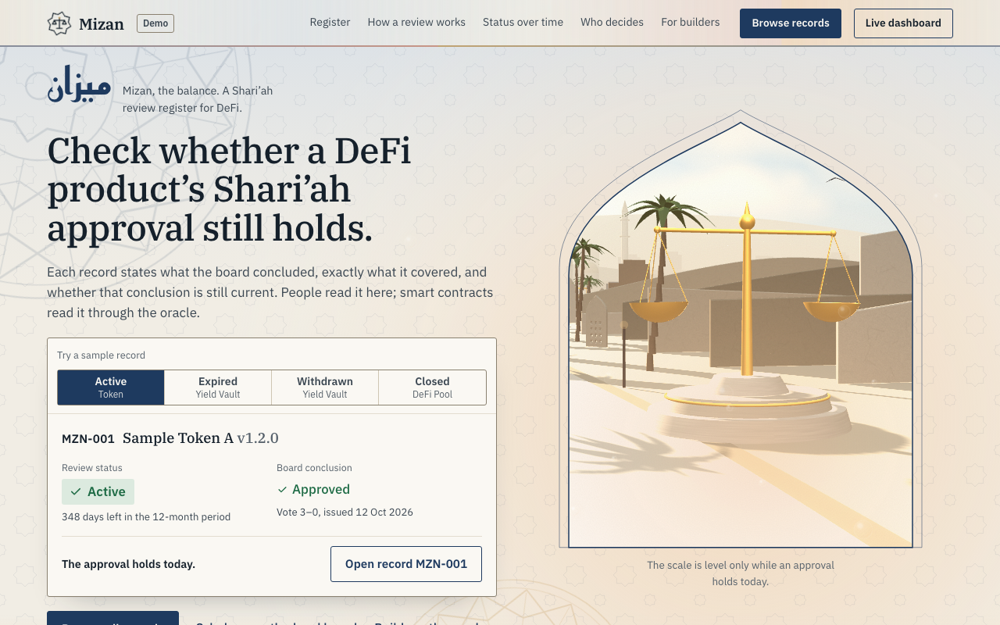
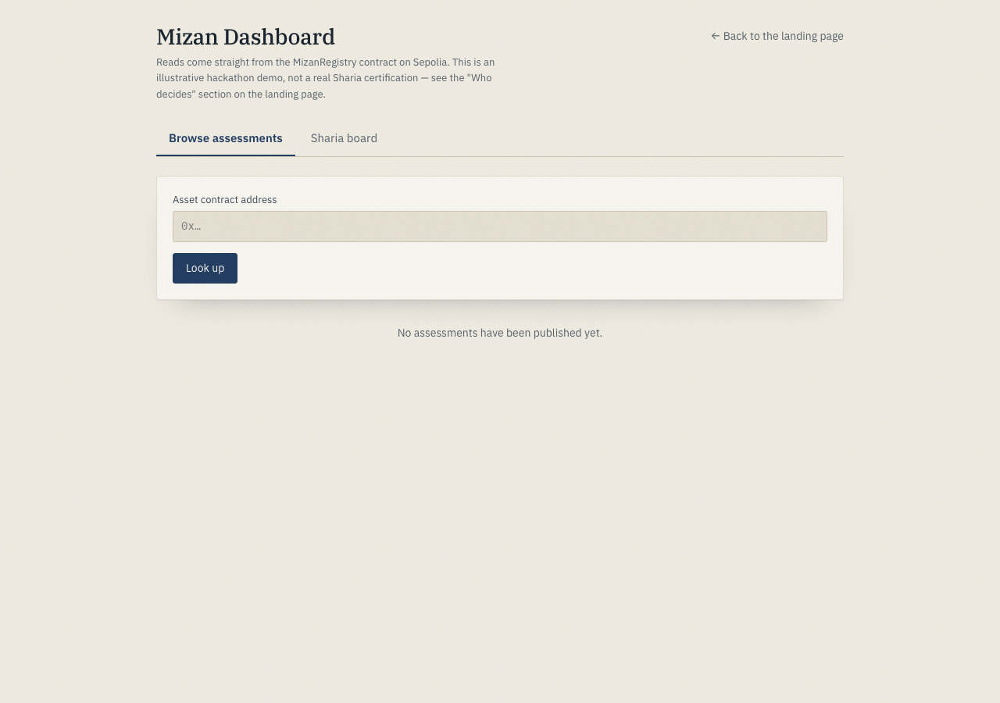
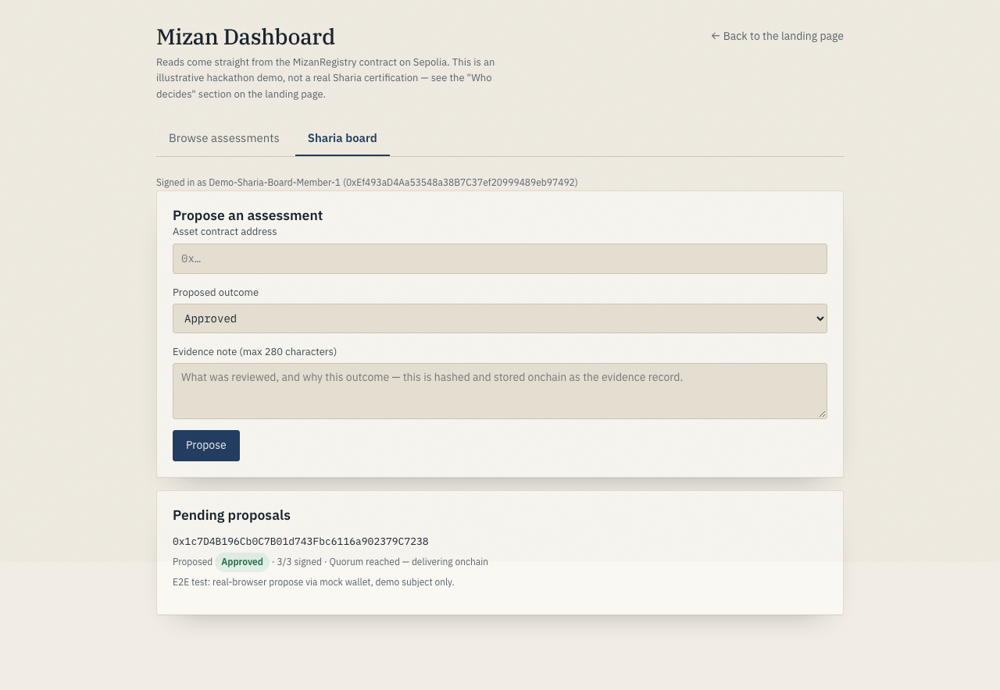

<p align="center">
  
</p>

<h1 align="center">Mizan ميزان</h1>
<p align="center"><strong>The balance.</strong> A Shari'ah review oracle for DeFi — board-signed, onchain, AI-assisted.</p>

<p align="center">
  <a href="#deployed-on-sepolia">Live on Sepolia</a> ·
  <a href="docs/demo/walkthrough.mp4">Watch the walkthrough</a> ·
  <a href="frontend/README.md">Dashboard</a> ·
  <a href="smart-contract/README.md">Contracts</a>
</p>

---

## What it does

Mizan gives a DeFi product a Shari'ah compliance status that a smart contract can check, not just a PDF a human has to trust. A Shari'ah board reviews an asset and each member signs their own opinion onchain; once enough members agree, the result is published through `MizanRegistry.resolve()` for anyone — a dashboard, a dApp, another contract — to read. For assets the board hasn't reached yet, a Chainlink CRE workflow asks an LLM for a non-binding preliminary screen, so nothing sits with no signal at all.

It's a hackathon build, but the whole loop runs for real: contracts deployed and source-verified on Sepolia, two Chainlink CRE workflows running end-to-end against them, and a dashboard that reads and writes the live chain.

## See it in action

<table>
<tr>
<td width="50%"></td>
<td width="50%"></td>
</tr>
<tr>
<td align="center"><em>Browse — live reads from the registry</em></td>
<td align="center"><em>Board — propose, sign, reach quorum</em></td>
</tr>
</table>

Full walkthrough: [`docs/demo/walkthrough.mp4`](docs/demo/walkthrough.mp4) — landing page → live dashboard → browse/lookup → connect wallet → propose → sign.

## How it works

1. **The Shari'ah board reviews an asset.** Each member signs their own opinion with EIP-712 typed data — a real per-member signature, not a shared key.
2. **Quorum decides the outcome.** `MizanRegistry` tallies opinions per member and only lets a result go live once enough of the board agrees, even if the board is split.
3. **A Chainlink CRE workflow delivers it onchain.** One workflow polls for quorum-reached board proposals and delivers them through `MizanReceiver`; a second asks an LLM for a preliminary AI read on assets still waiting on the board, and writes that separately.
4. **Anyone reads the result.** `resolve()` returns the current status onchain; the dashboard and public register make it human-readable too.

## What's here

| Path | What it is |
| --- | --- |
| [`smart-contract/`](smart-contract/) | The oracle: `MizanRegistry` (board opinions, quorum, `resolve()`), `MizanReceiver` (Chainlink CRE callback), the AI pre-screen pair, and a 64-test Foundry suite. Start with [smart-contract/README.md](smart-contract/README.md). |
| [`cre-workflow/ai-prescreen/`](cre-workflow/ai-prescreen/) | The Chainlink CRE workflow that fetches an asset, asks an LLM for a preliminary compliance screen, and writes the result onchain. Verified working end-to-end against live Sepolia contracts. |
| [`cre-workflow/board-opinion/`](cre-workflow/board-opinion/) | The Chainlink CRE workflow that delivers board-signed opinions onchain: polls the dashboard's backend for quorum-reached proposals, writes them through `MizanReceiver`. |
| [`frontend/`](frontend/) | The landing page / demo, **and** the live dashboard at `#/dashboard` (wallet connect, board propose/sign, browse real onchain assessments), plus its serverless backend (`frontend/api/`). See [frontend/README.md](frontend/README.md). |
| [`design-reviews/`](design-reviews/) | UX/trust/motion/a11y review notes from building the landing page. |

## Quick start

```bash
# Smart contracts (Foundry) — build, test, and a local Anvil smoke run
cd smart-contract && forge build && forge test -vv

# Frontend + live dashboard (React + Vite)
cd frontend && npm install && npm run dev   # http://localhost:5173
```

That's enough to explore the contracts and the UI locally. [smart-contract/README.md](smart-contract/README.md) and [frontend/README.md](frontend/README.md) cover the rest: running the CRE workflows, standing up the dashboard's backend, and deploying to Vercel.

## Deployed on Sepolia

Source verified (`exact_match`) on Sourcify for every contract below — see
[smart-contract/deployments/sepolia.json](smart-contract/deployments/sepolia.json) for full
deployment details, including the policy hash and CRE wiring.

| Contract | Address |
| --- | --- |
| MizanRegistry | [`0xAB7995471D8f075AE357c47AF884Ac814e6dBB38`](https://sepolia.etherscan.io/address/0xAB7995471D8f075AE357c47AF884Ac814e6dBB38) |
| MizanReceiver | [`0x6B2E8925bC577B79FA7aB3182Dd54afDDDE180AD`](https://sepolia.etherscan.io/address/0x6B2E8925bC577B79FA7aB3182Dd54afDDDE180AD) |
| MizanAIPreScreen | [`0x9952A0BBA59f1302BD9F707848c14D37C1fedE19`](https://sepolia.etherscan.io/address/0x9952A0BBA59f1302BD9F707848c14D37C1fedE19) |
| MizanAIReceiver | [`0x93Df89F20cd1cF145AaA6f07e339c58eaC02AdEe`](https://sepolia.etherscan.io/address/0x93Df89F20cd1cF145AaA6f07e339c58eaC02AdEe) |

`MizanRegistry`/`MizanReceiver` were redeployed once during the build to wire the receiver up to the
real Chainlink forwarder. See [smart-contract/deployments/sepolia.json](smart-contract/deployments/sepolia.json)
for the superseded addresses and the history.

`MizanAIPreScreen`/`MizanAIReceiver` are deliberately separate contracts from `MizanRegistry` — different
ABI shape entirely — so an AI pre-screen can never be mistaken for a board ruling. `resolve()` on the
registry is the only thing that's ever board-signed.

## How it was built

- **Solidity + Foundry** — `MizanRegistry` and `MizanReceiver`, with a 64-test suite (fuzzed expiry and tampered-evidence checks included), compiled for Solidity 0.8.24 and deployed to Sepolia.
- **Chainlink CRE** — two workflows, both verified live against the deployed contracts: an AI pre-screen (LLM call via OpenRouter → onchain write) and a board-opinion delivery pipeline (polls for quorum → delivers via the real CRE forwarder).
- **React 19 + Three.js** — the landing page is a hand-built paper-cut 3D scene; the `#/dashboard` route is a straightforward React app that reads and writes the chain directly.
- **Vercel serverless (`frontend/api/`)** — the thin coordination layer where board members sign off-chain before quorum is reached, so the CRE workflow has something to deliver onchain.

## A note on scope

This was built for a Chainlink hackathon to prove the full loop end-to-end — board sign-off, quorum,
onchain publication, and an AI pre-screen, all for real. The Shari'ah board here is a set of demo
wallets rather than seated scholars, and the policy text is illustrative rather than a real fatwa or
standard — everything else, from the signatures to the CRE delivery to the Sepolia deployment, is the
genuine mechanism.
