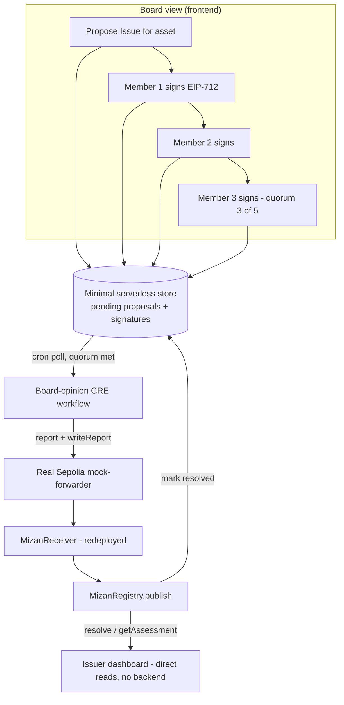

## Summary

A new, backend-free dashboard page lets anyone browse every real board-reviewed assessment and
look up a specific asset's resolution and AI pre-screen score. A second, narrower piece adds the
one backend component this project has never had — a minimal serverless store, scoped only to
board-opinion collection — so board members can propose, sign, and deliver real opinions through
the already-proven CRE forwarder pipeline, after redeploying the registry to a receiver wired to
that real pipeline instead of today's placeholder.

---

## Problem Frame

The only way to see Mizan's real on-chain state today is `cast call` run by hand, and the only way
to submit a board opinion is a Foundry script run by whoever holds the deployer key. Research
during planning also surfaced that the brainstorm's "reuse the proven CRE pipeline" decision for
board opinions isn't actually a drop-in: the live registry's receiver is wired to a placeholder
forwarder, and nothing in `MizanRegistry` represents a proposed-but-not-yet-quorate opinion, so
there is no shared place for independent board members' signatures to live before quorum is
reached.

---

## Requirements

**Chain & delivery infrastructure**

- R1. `MizanRegistry` and `MizanReceiver` are redeployed, wired to the real Sepolia Chainlink
  mock-forwarder and the same fixed debug workflow identity already proven working for AI
  pre-screen (see origin: `docs/brainstorms/2026-10-31-mizan-dashboard-requirements.md` R9).
- R2. A minimal serverless store holds pending Issue proposals and in-flight signatures for the
  board-opinion flow only — not used by the issuer/public view.
- R3. The store enforces one pending proposal per asset at a time and marks a proposal resolved
  once delivered on-chain; signatures arriving after resolution are rejected with an explicit
  "already finalized" response, not silently accepted or discarded.
- R4. A CRE workflow polls the store for proposals that have reached quorum, assembles the sorted
  `Opinion[]` array, and delivers it on-chain through the redeployed receiver (R1), using the same
  `report()` → `EVMClient.writeReport()` mechanism already proven for AI pre-screen.
- R5. At least one real board-signed assessment exists on the redeployed registry, produced by
  running the real propose → sign → deliver flow once with scripted signers (the existing
  `smart-contract/board-keys.local` wallets), not a bespoke one-off script.

**Issuer / public dashboard**

- R6. A dashboard page exists at a new route, separate from the existing landing page, reachable
  without introducing a server-side routing dependency.
- R7. The page shows a browsable list of every real board-reviewed assessment, read directly from
  the redeployed `MizanRegistry` by looping `assessmentCount`/`getAssessment(id)` — no backend.
- R8. The page offers an address lookup: paste an address or connect a wallet to prefill it, then
  show that asset's `resolve()` result and, if present, its `MizanAIPreScreen.getPreScreen()`
  result.
- R9. AI pre-screen results are shown for the known demo-asset list already used by the CRE
  pre-screen workflow, plus whatever address the user looks up directly — not a full browse of
  every AI-prescreened asset.
- R10. Wallet connection is read-only (address + prefill), not a session — no login persists
  across visits.

**Board member view**

- R11. Board members connect their wallet to propose a new Issue for an asset (when none is
  already pending for it) or to see one that's already pending and awaiting their opinion.
- R12. A board member signs their opinion (EIP-712, matching `MizanRegistry`'s nested
  `ShariaBoardMemberOpinion(Issue issue,uint8 opinion)` type including the registry's immutable
  `policyId`) in their browser wallet — no gas, no transaction, just a signature, submitted to the
  store from R2.
- R13. The board view shows each pending proposal's state plainly: awaiting signatures, quorum
  reached and awaiting delivery, delivered, or no-longer-collectible (superseded or arrived late).

---

## Key Technical Decisions

- **Redeploy `MizanRegistry` + `MizanReceiver` before any board-opinion work, wired to the real
  forwarder and the same fixed debug workflow identity (`workflowId` = 64 `1`s,
  `workflowOwner` = `0xaaaa...aaaa`) already proven delivering AI pre-screen reports.** The
  brainstorm's "reuse the proven pipeline" decision assumed this wiring already worked; research
  found the live registry's receiver is immutably wired to a placeholder instead
  (`smart-contract/deployments/sepolia.json`), and `setReceiver` can't be called twice
  (`MizanRegistry.sol:184-189`). This is a precondition, not a parallel task — R5's seed data must
  target the new registry so it isn't produced twice.
- **"No backend" is refined to scope only the issuer/public view (R6-R10), not the board view
  (R11-R13).** The board flow needs *something* durable and shared across independent board
  members' browsers to hold a proposal's fixed fields and in-flight signatures before quorum —
  `MizanRegistry` has no on-chain representation of a not-yet-quorate Issue
  (`MizanRegistry.sol:214-239` is the only path to an Assessment, and it requires quorum already
  met). A minimal serverless function + KV store, scoped to exactly this, is the smallest
  capability that satisfies the brainstorm's intent without reintroducing a general backend.
- **Issue proposal is a board-UI action backed by the same store, not an offline script.** Leaving
  proposal out of scope would make the dashboard undemoable interactively — every new assessment
  would require someone to run a script by hand between each one. A "Propose" action in the board
  view, writing into the same minimal store, keeps the whole flow self-serve.
- **One pending proposal per asset, enforced at propose time.** `_hashIssueStruct` signs every
  Issue field including `nonce` and `previousId` (`MizanRegistry.sol:365-382`); two concurrent
  proposals for the same asset would let one invalidate the other's signatures via
  `StaleAssessment` with no user-facing explanation. Rejecting a second proposal attempt while one
  is already pending avoids the race entirely rather than explaining it after the fact.
- **A proposal is marked resolved immediately after on-chain delivery is confirmed; signatures
  submitted after that point are rejected with an explicit status, not silently dropped.**
  `publish()` accepts the first `signed.length >= quorum`, not all active members
  (`MizanRegistry.sol:356`), so a slower signer can otherwise be left out with no indication why.
- **The board-opinion CRE workflow polls on a cron schedule, cloning the structure of
  `cre-workflow/ai-prescreen/`, rather than using an HTTP trigger.** Signatures arrive
  asynchronously from independent people; cron polling the store for "quorum reached" fits that
  better than a trigger that needs something to invoke it the instant quorum completes — and reuses
  a mechanism already proven working this session, which an HTTP trigger here would not be.
- **This workflow is not continuously running infrastructure.** Without real CRE deploy access
  (confirmed unavailable this session), the cron trigger only actually executes when manually run
  via `cre workflow simulate --broadcast`. The plan builds the workflow to the same proven shape as
  AI pre-screen, but delivery for this iteration is operator-triggered, not autonomous — this must
  be stated plainly in any demo or documentation, not implied away.
- **Wallet connection and EIP-712 signing use `viem` directly, not `wagmi`.** The actual surface
  needed — connect, read address, sign typed data, read-only calls — is narrow enough that `wagmi`
  adds a live v2/v3 compatibility question (v3 recommends TypeScript 5.9.3+; this project is on
  ~5.8.3) and a wallet-connector-UI ecosystem (AppKit, RainbowKit) still in beta on v3, for no
  capability this plan actually needs.
- **Routing is a hash-based route (e.g. `#/dashboard`), not a path-based route via a router
  library.** `frontend/src/App.tsx` has no router today, only a hash fragment that opens a modal
  (`App.tsx:20-23`). A hash route fits that precedent and needs no Vercel rewrite config; a
  path-based route would need one that doesn't exist yet.
- **Seed data (R5) comes from running the real flow once, not a bespoke script.** Proposing,
  signing with all 5 `board-keys.local` wallets, and letting the CRE workflow deliver it serves as
  the first integration test of the store and workflow together, rather than building a second,
  parallel path just for seeding.

---

## High-Level Technical Design



The issuer dashboard (right) never touches the store — it only ever reads `MizanRegistry` and
`MizanAIPreScreen` directly. The store exists solely to bridge the gap between "a board member
signed" and "quorum reached, deliverable," which has no on-chain representation.

---

## Scope Boundaries

- Deferred for later: browsing every AI-prescreened asset beyond the known demo list (carried
  forward from origin — no enumerator exists on `MizanAIPreScreen`).
- Deferred for later: requesting real CRE deploy access (`cre account access`) so the board-opinion
  workflow could run autonomously instead of being operator-triggered. Zero cost to request in
  parallel, but not a dependency of this plan.
- Out of scope: real Sign-In With Ethereum / session backend (carried forward from origin).
- Out of scope: any change to the existing illustrative landing page or
  `frontend/src/components/Register.tsx` (carried forward from origin).
- Out of scope: automated tests for the new frontend code. `frontend/` has no existing test setup
  (no vitest/jest config, no `*.test.*` files) — introducing one is a separate decision, not bundled
  into this plan.

---

## System-Wide Impact

This is the first plan in the project's history to introduce a backend component at all —
everything shipped before this (contracts, the CRE workflows, the existing frontend) is either
on-chain or a static client. Two consequences follow:

- **The project's deployment story splits in two for the first time.** Today "deploy" means one
  thing (Vercel, static build). After this plan, it means two: the static frontend and the
  serverless store's own environment (KV credentials, function config) — each with its own secrets
  surface. `ce-work` should keep these visibly separate rather than letting store credentials leak
  into `frontend/.env.example`, which documents client-exposed `VITE_` vars only.
- **The store becomes a second source of truth about assessment state, alongside the chain.** Every
  other read in this project (issuer view, existing CRE workflows) treats `MizanRegistry`/
  `MizanAIPreScreen` as the only authority. The board view's "pending" states are real but
  deliberately provisional — the store's job ends the moment `MizanRegistry.publish` succeeds. Any
  future feature reading board state must query the chain for anything already resolved and the
  store only for what's still pending, never treat the store as authoritative after resolution.

---

## Risks & Dependencies

- The minimal store (R2) is new infrastructure this project has never had. Whatever serverless
  platform/KV choice `ce-work` makes should stay within Vercel's free tier, since this is a
  hackathon deployment.
- The board-opinion CRE workflow (R4) depends on the redeploy (R1) landing first; building it
  against the current placeholder-wired registry would need to be redone.
- `wagmi`'s v2→v3 transition is live and AppKit/RainbowKit are beta-only on v3 as of this research
  — mitigated by the KTD to use `viem` alone, but worth re-checking versions at implementation time
  since this space moves fast.
- EIP-712 signing (R12) must reproduce `MizanRegistry`'s nested `ShariaBoardMemberOpinion(Issue
  issue,uint8 opinion)` type byte-for-byte, including the registry's immutable `policyId`, which is
  not part of the public `Issue` struct passed to `publish` — read `policyId` from the deployed
  contract rather than hardcoding it, since R1 produces a new value.

---

## Implementation Units

### Phase 1 — Chain & delivery infrastructure

### U1. Redeploy MizanRegistry + MizanReceiver wired to the real forwarder

**Goal:** Replace the placeholder-wired registry with one whose receiver can actually receive
delivery through the real Sepolia mock-forwarder, using the same fixed debug workflow identity
proven this session for AI pre-screen.

**Requirements:** R1

**Dependencies:** none

**Files:**
- `smart-contract/script/DeployNetwork.s.sol` (reference/reuse pattern; redeploy via the same
  `forge create` approach already proven reliable this session, not `forge script --broadcast`,
  which showed a reproducible gas-estimation failure against this RPC)
- `smart-contract/deployments/sepolia.json` (update with new addresses, note on the superseded
  deployment)
- `README.md` (update addresses)

**Approach:** Reuse the board roster, quorum, and policy already established for the current
registry — only the forwarder and workflow-identity constructor args change (real mock-forwarder
address, fixed debug `workflowId`/`workflowOwner`). Verify the new contracts on Etherscan the same
way as the existing deployment.

**Patterns to follow:** This session's own successful `forge create` + `cast send setReceiver`
sequence for the AI pre-screen contracts (same root cause: `forge script --broadcast` underestimates
gas against this RPC).

**Test scenarios:**
- Deploy succeeds and `cast call` confirms `receiver()` on the new registry returns the new
  receiver address.
- `cast call` confirms the new receiver's `forwarder()` returns the real mock-forwarder address,
  not the placeholder.

**Verification:** New addresses recorded in `deployments/sepolia.json`; both contracts show
verified source on Sepolia Etherscan.

---

### U2. Minimal serverless store for pending proposals and signatures

**Goal:** Give the board-opinion flow the shared, server-reachable place to hold a proposal's
fixed fields and in-flight signatures that `MizanRegistry` itself has no room for.

**Requirements:** R2, R3

**Dependencies:** none (independent of U1; can be built and tested with a stubbed registry address)

**Files:** new serverless function(s) + KV binding (exact platform primitive and file layout is
`ce-work`'s call; Vercel Functions + a KV store are the natural fit given the Vercel deploy target)

**Approach:** Model a pending proposal as the full set of `Issue` fields (asset, outcome,
evidenceHash/URI, boardIssuedAt, expiresAt, deadline, previousId, nonce) fixed once at propose
time, plus a list of collected `{ shariaBoardMember, opinion, signature }` entries. Enforce one
pending proposal per asset via an atomic check-and-create at the KV layer (e.g. a
set-if-not-exists on the per-asset key), not a read-then-write check from application code — two
concurrent propose requests for the same asset must not both succeed. Mark a proposal `resolved`
once R4's workflow confirms on-chain delivery; reject further signature submissions against a
resolved proposal with an explicit status rather than a generic error.

On each incoming signature, recover the signing address from `{ signature, digest }` and reject
(don't count toward quorum) unless it matches the claimed `shariaBoardMember` **and** that address
is one of the registry's active board members. `MizanRegistry.publish` would catch a bad signature
too, but only once quorum already looks reached and delivery is attempted — validating at
submission time keeps the board view's "2 of 3 signed" count honest instead of showing false
progress that fails later with a confusing on-chain revert.

**Technical design:** (directional, not implementation-ready)
```
POST /propose   { asset, outcome, evidenceHash, evidenceURI, expiresAt, deadline }
                 -> fixes previousId (read from chain), nonce (generated), boardIssuedAt (now)
                 -> atomic create; 409 if a pending proposal already exists for this asset
GET  /pending    -> list of proposals with status: awaiting_signatures | quorum_reached | resolved
POST /sign       { proposalId, shariaBoardMember, opinion, signature }
                 -> 409 "already finalized" if proposal.status == resolved
                 -> 400 if the signature doesn't recover to an active board member's address
POST /resolve    { proposalId, assessmentId }   (called by the CRE workflow after delivery)
```

**Patterns to follow:** None exist yet in this repo — this is the first backend component.

**Test scenarios:**
- Propose an asset with no pending proposal: succeeds, returns a proposal with a fixed nonce.
- Propose the same asset again while one is pending: rejected (409), existing proposal untouched.
- Two propose requests for the same asset fired concurrently: exactly one succeeds, the other gets
  409 — not a race where both create a proposal.
- Sign a pending proposal 3 times from 3 different active board members: proposal transitions to
  `quorum_reached`.
- Submit a signature that doesn't recover to the claimed board member's address: rejected (400),
  not counted toward quorum.
- Submit a signature from an address that recovers correctly but isn't an active board member:
  rejected (400).
- Sign a proposal after it's been marked `resolved`: rejected with an explicit "already finalized"
  response, not a generic error.
- Sign with a duplicate address already recorded for the same proposal: idempotent, not double
  counted.

**Verification:** All scenarios above pass against a deployed (or local-emulated) instance of the
store.

---

### U3. Board-opinion CRE workflow

**Goal:** Deliver quorate proposals from U2's store on-chain, through U1's redeployed receiver,
using the same mechanism already proven for AI pre-screen.

**Requirements:** R4

**Dependencies:** U1, U2

**Files:**
- New workflow directory alongside `cre-workflow/ai-prescreen/` (e.g.
  `cre-workflow/board-opinions/`), cloning its `main.ts`/`workflow.ts`/`config.*.json`/
  `workflow.yaml` structure

**Approach:** Replace `ai-prescreen`'s OpenRouter-fetch step with a call to U2's `GET /pending`
endpoint, filter for `quorum_reached`, build the sorted-by-address `Opinion[]` array from the
stored signatures, ABI-encode the report exactly as `MizanReceiver.onReport` expects
(`abi.encode(uint8(2), uint8(0), abi.encode(input), abi.encode(signed))`, matching
`CRE-INTEGRATION.md`'s report schema), then reuse the proven `runtime.usingTheDons().report(...)`
→ `EVMClient.writeReport(...)` sequence from `cre-workflow/ai-prescreen/workflow.ts`. On confirmed
delivery, call U2's `POST /resolve`.

**Patterns to follow:** `cre-workflow/ai-prescreen/workflow.ts` end to end — trigger shape
(`CronCapability`, `handlerInTee`), the `report()`/`writeReport()` delivery call, and `config.*.json`
+ `workflow.yaml` structure.

**Test scenarios:**
- `cre workflow simulate` against a stubbed `quorum_reached` proposal: produces the correct
  ABI-encoded report bytes (compare against a manually-constructed expected payload).
- `cre workflow simulate --broadcast` against a real quorate proposal on U2: delivers successfully,
  `MizanRegistry.getAssessment` reflects the new assessment, and U2's proposal is marked resolved.
- A proposal with fewer than quorum signatures is not picked up by the poll.

**Verification:** A real `--broadcast` run against a genuinely quorate proposal produces a
successful transaction and an on-chain assessment matching the proposal's fields.

---

### U4. Seed the first real assessment

**Goal:** Produce R5 by running the real flow once end to end, proving U1-U3 work together.

**Requirements:** R5

**Dependencies:** U1, U2, U3

**Files:** none new — a one-off operational run, not a committed script, unless `ce-work` judges a
small reusable script worth keeping for future re-seeding

**Approach:** Call U2's propose endpoint for one demo asset, sign with all 5
`smart-contract/board-keys.local` wallets (reusing `LocalDemo.s.sol`'s ascending-address-sort and
`hashOpinion`-signing pattern, adapted to call U2's `/sign` endpoint instead of a direct contract
call), then run U3's workflow with `--broadcast` to deliver it.

**Patterns to follow:** `smart-contract/script/LocalDemo.s.sol` for the signing logic (sort by
address, sign `hashOpinion(input, opinion)` per member) — adapted to produce signatures for U2's
API rather than calling a mock forwarder directly.

**Test scenarios:**
- `Test expectation: none` — this is a one-off operational run verified by its outcome (see
  Verification), not a unit with its own test suite.

**Verification:** `MizanRegistry.assessmentCount()` on the redeployed registry is at least 1, and
`resolve(asset)` for the seeded asset returns a non-empty result.

---

### Phase 2 — Frontend dashboard

### U5. Dashboard route, env config, and read client setup

**Goal:** Establish the new page's entry point and the shared on-chain read client, with no
backend involved.

**Requirements:** R6

**Dependencies:** U1 (needs the final registry address to configure)

**Files:**
- `frontend/src/App.tsx` (add hash-route detection, mounting the new dashboard instead of the
  existing landing content when the hash matches)
- New dashboard page component and a `viem` public-client setup module under
  `frontend/src/components/` / a new `frontend/src/lib/` module
- `frontend/.env.example` (new — document every `VITE_`-prefixed var)
- `frontend/package.json` (add `viem`)

**Approach:** Hash-based route (e.g. `#/dashboard`), consistent with the existing
`#record/MZN-004` precedent (`App.tsx:20-23`) and avoiding any Vercel rewrite-config dependency.
`viem`'s `createPublicClient` against a `VITE_SEPOLIA_RPC_URL`.

**Patterns to follow:** `frontend/src/hooks/useMedia.ts` / `useReducedMotion.ts` for any new hook's
shape (small, typed, explicit cleanup); extend the single global stylesheet rather than adding a
second styling system.

**Test scenarios:**
- `Test expectation: none -- no test harness exists in frontend/ yet (see Scope Boundaries); verify
  manually via `npm run dev`.`

**Verification:** Navigating to the dashboard hash route renders the new page shell without
affecting the existing landing page at the root path.

---

### U6. Issuer / public view: browse list and address lookup

**Goal:** Deliver R7-R10.

**Requirements:** R7, R8, R9, R10

**Dependencies:** U5

**Files:** new components under `frontend/src/components/` for the browse list and lookup form;
reuse `frontend/src/components/JsonView.tsx` and `Status.tsx` for raw-payload and outcome-badge
display

**Approach:** Browse list loops `assessmentCount()`/`getAssessment(id)` client-side (no backend).
Lookup reads `resolve(address)` and, for the known demo-asset list (mirrored from
`cre-workflow/ai-prescreen/config.staging.json`) or any directly-looked-up address,
`getPreScreen(address)`. Wallet connect (read-only) prefills the lookup field with the connected
address.

**Patterns to follow:** `frontend/src/components/Register.tsx` / `RecordModal.tsx` for table and
detail-view structure and accessibility conventions (`aria-live`, `aria-pressed`, `sr`-only
captions) — matched, not copied, since this view shows real (not illustrative) data and needs its
own copy.

**Test scenarios:**
- Address with a resolution but no AI pre-screen entry: shows the resolution, indicates no
  pre-screen exists — not an error. Covers AE1.
- Address with neither: shows a clear "not yet reviewed" state, not an empty/blank page. Covers
  AE2.
- Browse list reflects the seeded assessment from U4 after it lands.
- Wallet-connect prefill: connecting populates the lookup field with the connected address without
  requiring a page reload.

**Verification:** Both AE1 and AE2 states are reachable and visually distinct from each other and
from the populated state.

---

### U7. Wallet connect and EIP-712 signing utility

**Goal:** Provide the shared `viem`-based connect/sign capability both the issuer view (read-only
prefill) and board view (signing) use.

**Requirements:** R10, R12 (shared utility, not a standalone requirement)

**Dependencies:** U5

**Files:** new module under `frontend/src/lib/` (e.g. wallet connect + typed-data signing helpers)

**Approach:** `viem`'s `custom(window.ethereum)` transport for connect + `signTypedData`, no
`wagmi`. The signed type must match `MizanRegistry`'s domain (`name: "MizanOracle"`, `version:
"1"`, `chainId: 11155111`, `verifyingContract`: the redeployed registry's address) and the nested
`Issue` / `ShariaBoardMemberOpinion(Issue issue,uint8 opinion)` types exactly, including the
registry's immutable `policyId` read live from the contract (`policyId()`) rather than hardcoded,
since U1 produces a new value.

**Execution note:** Verify the constructed digest matches `MizanRegistry.hashOpinion(...)` read
from the contract before wiring this into the board view — a mismatch here fails silently as
`InvalidSignature` on delivery, not at signing time.

**Patterns to follow:** `MizanRegistry.sol:136-140` (`ISSUE_TYPE`, `OPINION_TYPEHASH`) for the exact
field list and nesting.

**Test scenarios:**
- Signing a known Issue+opinion produces a signature that `ECDSA.recover` (or an equivalent
  off-chain check) resolves to the connected address.
- Constructed EIP-712 digest matches `hashOpinion(input, opinion)` read from the deployed contract
  for the same inputs.
- Read-only connect (issuer view) never prompts for a signature, only an address.

**Verification:** A signature produced by this utility, submitted through U2 and delivered by U3,
is accepted by `MizanRegistry.publish` without an `InvalidSignature` revert.

---

### U8. Board member view

**Goal:** Deliver R11-R13.

**Requirements:** R11, R12, R13

**Dependencies:** U2, U6 (shares layout/route shell), U7

**Files:** new components under `frontend/src/components/` for the board view (propose action,
pending list, sign action, status display)

**Approach:** Connect wallet (U7) → list pending proposals from U2 (`GET /pending`) → propose a
new one (`POST /propose`) when none exists for a chosen asset → sign (U7) and submit (`POST
/sign`) → poll or refetch to reflect `awaiting_signatures` → `quorum_reached` → `resolved`
transitions, plus the `already finalized` / no-longer-collectible state from U2/U3's resolution
handling.

**Patterns to follow:** Same accessibility and component conventions as U6; reuse the outcome-badge
component rather than inventing a second status-display pattern.

**Test scenarios:**
- Propose an asset with no pending proposal: succeeds, shows the new pending state. Covers AE3 (not
  yet quorate).
- Attempt to propose an asset that already has a pending proposal: UI surfaces the rejection
  clearly, does not silently fail.
- Sign a pending proposal: UI reflects the updated signature count without a full page reload.
- View a proposal after it's been resolved (delivered): shows `resolved`, not `pending`. Covers AE3
  (quorum delayed but eventually resolved).
- Attempt to sign an already-resolved proposal: shows the "already finalized" state from U2, not a
  generic error.

**Verification:** All five scenarios above are reachable through the UI without needing direct API
calls.

---

### U9. Vercel deployment configuration

**Goal:** Make the full feature (frontend + minimal backend) deployable on Vercel as described to
the user.

**Requirements:** supports R1-R13 collectively; no new product requirement of its own

**Dependencies:** U1-U8 complete

**Files:** `frontend/.env.example` (finalize from U5's draft), Vercel project environment variable
configuration (dashboard-side, not a repo file), any serverless-function config Vercel requires for
U2

**Approach:** Document every `VITE_`-prefixed var the frontend needs (RPC URL, the redeployed
registry and AI pre-screen addresses, chain ID) and every var the serverless store needs (KV
connection credentials). Since this is a static-build SPA, every `VITE_` var is public in the
shipped bundle by construction — call this out explicitly so no one later puts a sensitive value
behind a `VITE_` prefix. No `vercel.json` SPA rewrite is needed given the hash-routing decision
(U5).

**Test scenarios:**
- `Test expectation: none -- this is configuration, not behavior; verified by a successful Vercel
  deploy reaching both the issuer and board views.`

**Verification:** A fresh Vercel deployment, configured only from documented env vars, serves both
dashboard views and the board view's propose/sign actions reach the serverless store successfully.

---

## Sources / Research

- `docs/brainstorms/2026-10-31-mizan-dashboard-requirements.md` — origin requirements doc.
- `smart-contract/deployments/sepolia.json` — confirms the live registry's receiver is wired to a
  placeholder forwarder, not the real one.
- `smart-contract/src/MizanRegistry.sol:184-189, 214-239, 356, 365-394` — `setReceiver` immutability,
  `publish`'s quorum-only gate, signer-sorting and signature-verification requirements.
- `smart-contract/script/LocalDemo.s.sol` — the signing pattern U4 adapts.
- `cre-workflow/ai-prescreen/workflow.ts` — the proven cron/report/writeReport pattern U3 clones.
- `smart-contract/docs/CRE-WORKFLOW-PLAN.md` §4-§7 — anticipated this exact redeploy/offline-signer
  gap ahead of this planning pass.
- Framework research (this session): `wagmi` v3 recommends TypeScript ≥5.9.3 (project is on ~5.8.3)
  and wallet-connector UIs (AppKit, RainbowKit) are beta-only on `wagmi` v3 as of this research —
  basis for the viem-only KTD. Vite's `VITE_` env-var prefix convention and Vercel's per-environment
  dashboard configuration confirmed current as of this research.
