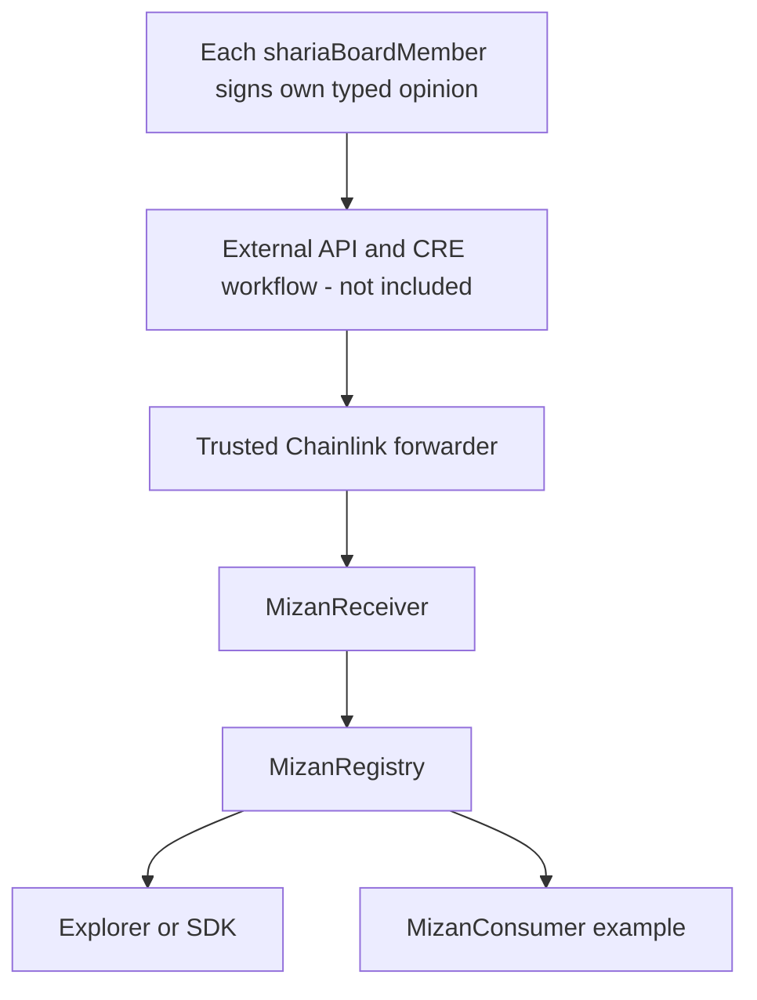

# Mizan onchain design

Version 1.0 - 29 October 2026

## 1. What the contracts do

Mizan publishes an assessment **issued by a Sharia board of named members**, together with who gave which opinion and how many agreed. It does not independently decide what is halal, certify a real product, assess investment safety, or establish legal permission to operate.

This implementation makes four questions answerable:

1. Which registered Sharia board members gave an opinion on this exact assessment, what did each say, and did a quorum agree with the proposed outcome?
2. Did it arrive through the configured delivery receiver/workflow?
3. Is it the latest assessment for this product?
4. Has it expired, been revoked, or become unavailable for reliance because the board is suspended?

## 2. Small architecture



For local tests, `MockForwarder` replaces only the transport entry point. It **does not verify DON signatures and does not run CRE**. The receiver still verifies metadata, and the registry still verifies real cryptographic signatures from each Sharia board member.

### Why two contracts?

- `MizanReceiver` checks **how the message arrived**.
- `MizanRegistry` checks **who authorized the content and whether the update is valid**.

This avoids one large contract mixing transport details with assessment logic. The example consumer shows how application policy stays separate.

## 3. Deployment boundaries

A registry has one Sharia board roster with a quorum, and one immutable policy ID/hash/URI. The URI is a storage string with no update function; its hash and ID are Solidity immutables. The registry address and chain identify the deployment. Sharia board members can be added, renamed, deactivated, and the quorum changed by the owner; a new policy version requires a new registry in this MVP.

An asset is its contract address on the deployment chain. It must have deployed code at publication. The registry does not verify ERC-20 behavior, inspect proxy upgrades, or determine the actual financial mechanism. Local mock assets are identity-only contracts, not tokens.

`subjectVersion` identifies the version described in the evidence. It is a board assertion, not an independently measured code hash. Scope, exclusions, dependencies, findings, and limitations live in the exact evidence document whose hash is signed.

## 4. Assessment model

| Field | Meaning |
|---|---|
| asset | Address of the assessed product contract |
| subjectVersion | Board-defined version commitment |
| outcome | Unset (invalid for publication), Approved, Rejected, NeedsReview |
| evidenceHash | Keccak-256 of the exact evidence-file bytes |
| evidenceURI | Signed evidence location; 1 to 512 bytes |
| boardIssuedAt | Board-declared signing time, not independent timestamp proof |
| expiresAt | Review validity ends at this timestamp |
| deadline | Last timestamp when the signature may be delivered |
| previousId | Expected current latest record, or zero for first publication |
| nonce | Registry-wide single-use nonce, shared across action types |

The stored record also contains a `Tally` (approvals, rejections, needsReview, the quorum, the active board size at publication, and `quorumMet`), `recordedAt` (block time), revocation flag/reason, and revocation time. `getAssessment(id)` returns the full record, including superseded records. `getOpinions(id)` returns each member address and the opinion that member signed; `getRevokers(id)` returns the Sharia board members who signed a revocation.

### Sharia board

| Read | Returns |
|---|---|
| `getShariaBoardMembers()` | Every address ever added to the roster, active or not |
| `shariaBoardMembers(address)` | `name`, `profileURI`, `active` |
| `activeShariaBoardMemberCount()` / `quorum()` | Current board size; minimum signers and minimum agreeing opinions |
| `getOpinions(id)` | `(shariaBoardMember, opinion)[]` for an assessment, ascending by address |
| `resolve(asset).tally` | Counts for the latest assessment, e.g. "3 of 5 approved, 1 needs review, quorum 3, quorumMet true" |
| `getOutcome(id)` | Effective outcome of any record, including superseded ones |

The address is the Sharia board member's identity; name and profile URI are owner-maintained display metadata, so a rename changes how past opinions are displayed but not who signed them. Deactivated Sharia board members stay in the roster and in historical opinions, but their new signatures are rejected. At most 32 Sharia board members can be active.

Each Sharia board member gives their **own** opinion (`Approved`, `Rejected`, or `NeedsReview`) on the same `Issue`. Dissenting opinions are verified and recorded, not discarded. `Issue.outcome` is the **proposed** outcome. Publication needs at least `quorum` members to sign, whatever their opinions, so a lone member cannot replace the latest record. Then:

| Opinions matching the proposal | Stored? | Effective outcome (`resolve`, `getOutcome`) | `tally.quorumMet` |
|---|---|---|---|
| At least `quorum` | Yes | The proposed outcome | true |
| Fewer than `quorum` (split board) | Yes | `NeedsReview` | false |
| Fewer than `quorum` members signed at all | No, reverts `QuorumNotMet(signed, quorum)` | | |

So the counts and the names are always readable for a stored record, including a split board (for example 1 approved, 1 rejected, 1 did not sign). The proposed outcome stays in `getAssessment(id).review.outcome` for history, but apps must use the effective outcome. Members who did not sign do not appear in `getOpinions`.

Publication accepts a previously expired assessment when the delivery signature is still within its deadline. `resolve()` then truthfully reports `expired=true`. It never makes an old assessment appear current.

## 5. Signing and trust

Uses OpenZeppelin EIP712 and ECDSA rather than custom cryptography.

Domain:

```text
name: MizanOracle
version: 1
chainId: current deployment chain ID
verifyingContract: MizanRegistry address
```

Issue type (exact field order):

```text
Issue(bytes32 policyId,address asset,bytes32 subjectVersion,uint8 outcome,bytes32 evidenceHash,string evidenceURI,uint64 boardIssuedAt,uint64 expiresAt,uint64 deadline,uint256 previousId,uint256 nonce)
```

`policyId` is inserted from the immutable registry configuration when hashing. It is not an input field in the Solidity `Issue` struct. Offchain typed-data signers must include it in their EIP-712 message.

`ShariaBoardMemberOpinion` type (what each Sharia board member signs; nested EIP-712 struct):

```text
ShariaBoardMemberOpinion(Issue issue,uint8 opinion)Issue(bytes32 policyId,address asset,...same Issue fields as above...)
```

The full type string is `"ShariaBoardMemberOpinion(Issue issue,uint8 opinion)"` followed by the Issue type string above. Because the whole Issue is nested, wallets that render EIP-712 show the Sharia board member what they are signing.

Revoke type:

```text
Revoke(uint256 assessmentId,bytes32 reasonHash,string reasonURI,uint64 deadline,uint256 nonce)
```

The registry domain binds both action types to this registry and chain. EIP-712 does **not** supply application replay protection; the registry-wide `usedNonce[nonce]` does. `hashOpinion(issue, opinion)` and `hashRevoke()` expose the final signing digests for integrations and local scripts. Signatures are submitted in strictly ascending member-address order, which makes counting the same Sharia board member twice impossible.

Strings use EIP-712's string hashing rules. The signature covers the evidence location as well as its hash. A relay cannot alter the URI, conclusion, expiry, predecessor, or nonce without invalidating it.

`boardIssuedAt` must be nonzero and no later than block time. `expiresAt` must be later than `boardIssuedAt`. Delivery is accepted at exactly `deadline`, but rejected afterward. Board clocks ahead of the chain must wait or sign again; there is no hidden clock-skew tolerance.

## 6. Publication and concurrency

1. Caller must be the one-time configured receiver.
2. Board must be active.
3. Product/evidence/timestamps must be valid.
4. `previousId` must equal `latestId[asset]`.
5. Delivery must be within deadline and the nonce unused.
6. Every opinion must come from an active Sharia board member, in ascending address order, with a valid signature for that exact opinion; at least `quorum` members must sign. The effective outcome is the proposal if at least `quorum` opinions match it, otherwise `NeedsReview`.
7. Create an immutable record and update the latest pointer.

If two updates reference the same predecessor, only the first accepted one succeeds. Different products can update independently; nonces need not be sequential, but must be unique per registry. A revert rolls back nonce consumption.

A duplicate delivery reverts (usually stale predecessor or used nonce). It is **not** a successful no-op. An offchain retry worker should check current state and mark an already-accepted digest as acknowledged rather than keep retrying it.

## 7. Revocation and history

A revocation needs signatures from at least `quorum` active Sharia board members (recorded in `getRevokers`), unused nonce, unexpired delivery deadline, known target, and nonempty reason commitment/location. It cannot be applied twice.

Revocation:

- Is permanent for that assessment.
- Does not erase its conclusion or evidence.
- Does not change `latestId`.
- Never brings an older approval back into effect.
- Can target historical records without revoking a newer replacement.

A fresh approved replacement can restore application eligibility while the old revoked record remains in history.

Revocation remains possible while the board is suspended. This is intentional for withdrawing records. A quorum of compromised Sharia board member keys can still withdraw records until the owner deactivates them. This is a documented availability/trust tradeoff, not a complete incident-response system.

## 8. Raw result versus application rules

`resolve(asset)` returns `exists`, record ID, outcome, expired, revoked, boardActive, the opinion tally, version/evidence, and dates. It reads **only the latest record**, never scans backward for an approval.

The consumer example implements:

| Latest state | None (0) | PriorApproval (1) | CurrentApproval (2) |
|---|---:|---:|---:|
| No record | Allow | Block | Block |
| Approved, current | Allow | Allow | Allow |
| Approved, expired | Allow | Allow | Block |
| Rejected / NeedsReview | Allow | Block | Block |
| Revoked | Allow | Block | Block |
| Board suspended | Skip review gate | Block | Block |

`block.timestamp >= expiresAt` means expired, with no cron transaction needed. “Allow” only means passing this example gate. It is not certification or a trade. There is no deposit locking, maturity, custody, or forced unwinding.

## 9. Receiver authorization

`MizanReceiver` fixes these values at deployment:

- Registry contract.
- Trusted forwarder contract.
- Expected workflow ID.
- Expected workflow owner.

It implements `onReport(bytes,bytes)` and ERC-165 support. It checks both the forwarder and workflow identity; trusting a shared forwarder alone would accept other workflows too.

Metadata uses the documented packed prefix: 32-byte workflow ID, 10-byte name, 20-byte owner. This implementation accepts exactly 62 or 64 bytes. Production's two extra report-ID bytes are supported. Name is not used for authorization; exact workflow ID plus owner are required.

These checks authenticate fields **only when the configured forwarder is trusted**. The receiver does not re-verify DON signatures; the real forwarder does that upstream. A mock forwarder cannot provide production security.

## 10. Administrator powers

OpenZeppelin Ownable2Step provides explicit transfer/acceptance. The owner can:

- Set a deployed receiver exactly once.
- Add, rename, deactivate, or reactivate Sharia board members, and change the quorum (never above the active count).
- Suspend or restore board activity.
- Transfer ownership with acceptance, or renounce it (standard Ownable behavior).

The owner cannot edit an old assessment in place. However, it can appoint Sharia board members, so it remains a trusted root authority over who counts as the board. Deactivating a Sharia board member does not invalidate already accepted records; their pending signatures fail. Renouncing ownership permanently removes recovery/configuration powers; do not do this accidentally.

An accidentally configured receiver cannot be changed. Deploy again if transport configuration is wrong. This deliberate immutability keeps the MVP small and readable.

## 11. Security and operational limits

- No external URI fetch occurs inside contracts. Evidence availability/meaning must be checked offchain.
- URI strings are size-bounded. No unbounded history loops.
- OpenZeppelin signature validation makes no calls to the asset or signer (EOA only).
- Block time is suitable for coarse review periods, not precise financial timing guarantees.
- Evidence is public; do not publish private client or reviewer information.
- No upgrade proxy, external arbitrary-call dispatcher, funds, or third-party token approvals.
- Receiver delay means the onchain result may lag the board's latest offchain decision.
- No emergency direct-publish path bypasses the receiver.
- Mainnet readiness needs independent review, real board governance, correct network/workflow configuration, and live transport validation. Passing tests is not an audit.

## 12. Official references

- EIP-712: https://eips.ethereum.org/EIPS/eip-712
- OpenZeppelin cryptography: https://docs.openzeppelin.com/contracts/5.x/api/utils#cryptography
- OpenZeppelin ownership: https://docs.openzeppelin.com/contracts/5.x/access-control
- CRE consumer contracts and metadata: https://docs.chain.link/cre/guides/workflow/using-evm-client/onchain-write/building-consumer-contracts
- Foundry: https://getfoundry.sh/

Sources consulted 29 October 2026. Interface-compatible local tests do not establish live CRE compatibility on a particular deployment.
